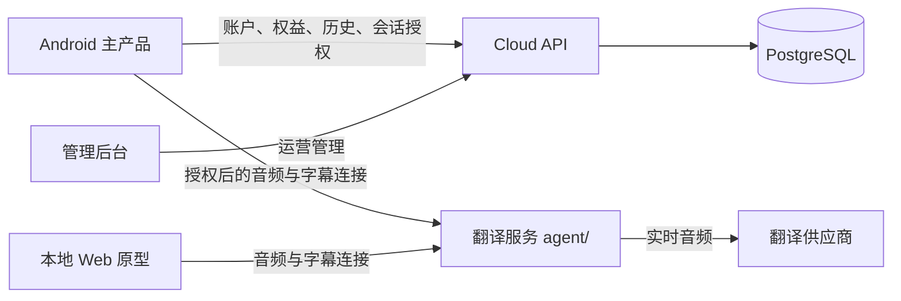

# 项目结构与模块职责

本页对应本轮整理基线 `main@f26d690`。候选 PR、已发布 APK 和运行中服务的差异见[仓库状态](development/repository-status.md)。

## 代码地图

| 模块 | 路径 | 主要职责与相邻模块 |
|---|---|---|
| Android | [android/](../android/) | Kotlin/Compose 页面、收音与播放、WebSocket、Cloud 账户和历史；页面变化也可能触及 ViewModel 与音频生命周期 |
| 翻译服务 | [agent/](../agent/) | 校验翻译连接、转换供应商协议、转发字幕和 PCM；与 Android/Web 协议及 Cloud 授权契约相邻 |
| Cloud API | [cloud-api/](../cloud-api/) | 账户、权益、翻译授权、加密历史、用量与更新元数据；被 Android、管理后台及翻译服务调用 |
| 管理后台 | [cloud-api/admin-web/](../cloud-api/admin-web/) | 运营管理页面；依赖 Cloud API 的鉴权、数据结构与分页契约 |
| Web 原型 | [web/](../web/) | 本地调试和辅助原型；开发脚本仍使用它，其行为不能替代 Android 规格 |
| 数据库 | [migrations/](../migrations/) | PostgreSQL 表结构及迁移；与 Cloud 存储和部署配套 |
| 品牌与工具 | [branding/](../branding/)、[scripts/](../scripts/) | 项目资源及开发、构建工具 |

`agent/` 是产品服务，不是 AI 编码代理。供应商凭据由服务端持有，客户端消费项目自身的音频和字幕协议。

## 评估修改影响

| 改动位置 | 需要一起核对的边界 |
|---|---|
| 页面、按钮与导航 | ViewModel 状态、收音开始/停止、暂停恢复、后台与返回行为 |
| Cloud 路由或响应字段 | [API 文档](../cloud-api/API.md)、Android Cloud 客户端、管理后台，以及适用的 Agent 调用 |
| 翻译连接和事件 | Android/Web 的连接与字幕处理、PCM 格式、播放结束、Cloud 会话授权 |
| 数据库存储 | 迁移、Cloud 读写、历史同步与账户隔离 |
| 版本、签名和下载 | 构建来源、包名、versionCode、签名、APK 哈希、更新 API |

这张表是代码关系说明，不代表这些边界已经通过回归。自动测试、真实数据库、真机音频和供应商容量分别需要相应证据。
