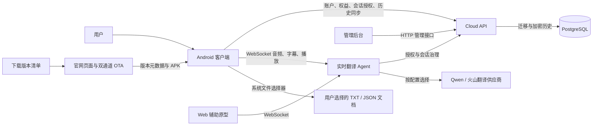

# 模块与依赖地图

效力：针对 v30 源码 `cd920a1` / 发布资料 `dc587ef` 整理的源码导航，当前候选随后加入分批整理提交；v30 用户已更新，尚未测试。连线表示源码依赖或交互，不表示本轮已跑通线上服务、供应商或跨设备链路。

## 主要链路

Android 先从 Cloud API 获取翻译会话授权，再以约定的握手和 `start` 字段连接 Agent。Agent 校验签名、绑定字段并向 Cloud 检查会话有效性；只修改 UI 也可能改变取消、恢复、授权释放及采集时机，需要按实际触及的控制链路检查。

历史链路与实时语音链路不同：已完成 Turn 写入本机历史副本，再通过 Cloud API 同步云端历史副本；删除优先保护已删除会话不会被迟到上传恢复。TXT/JSON 导出使用用户选择的文档提供方，已经交付给外部文件的明文不随退出登录自动收回。

## 模块职责与变更影响

| 模块 | 职责与主要源码 | 上游 / 下游与影响 |
| --- | --- | --- |
| Android 工作台 | [UI 与控制](../../android/app/src/main/java/com/verba/interpretation/ui/)、[云端调用](../../android/app/src/main/java/com/verba/interpretation/cloud/) | 接受用户操作，调用 Cloud 与 Agent。界面、生命周期、手势和翻译控制改动可能影响收音、Turn 结束、字幕、播放与授权释放 |
| Android 历史与导出 | [history/](../../android/app/src/main/java/com/verba/interpretation/history/)、[export/](../../android/app/src/main/java/com/verba/interpretation/export/) | 消费已完成 Turn 与账户身份；影响 Room 持久接纳、保存反馈、重试、账号隔离、同步、删除优先和系统文件写入 |
| Agent | [WebSocket 服务](../../agent/internal/server/)、[供应商客户端](../../agent/internal/ast/)、[授权](../../agent/internal/sessionauth/) | 服务 Android 和 Web，依赖供应商与 Cloud。协议字段、事件次序、取消与完成语义影响客户端和历史留存；Agent 是活动后端 |
| Cloud API | [HTTP 路由](../../cloud-api/internal/http/router.go)、[领域](../../cloud-api/internal/domain/)、[存储](../../cloud-api/internal/store/)、[历史加密](../../cloud-api/internal/historycrypto/) | 服务 Android、Agent 与管理后台；依赖 PostgreSQL 和[根迁移目录](../../migrations/)。改字段、授权、账户或历史语义需要检查消费者与独立契约模块 |
| 管理后台 | [界面与接口使用](../../cloud-api/admin-web/src/)、[运行说明](../../cloud-api/admin-web/README.md) | 消费 Cloud 管理接口；鉴权、响应结构或管理动作变更可能同时影响后台。后端接口存在不等于界面提供全部操作 |
| Web 辅助原型 | [源码](../../web/)、[开发说明](../development/web-prototype.md) | 仍由活动脚本启动并使用 Agent；不是 Android 功能规格，也不能整体当作废弃源码移动 |
| 下载与更新 | [清单](../../site/download/releases.json)、[模板](../../site/download/index.template.html)、[发布工具](../../scripts/)、[操作说明](../deployment/download-center.md) | 清单驱动网页及两通道 OTA，关联 APK、签名、版本和 Cloud 更新回退；本地测试不证明公网下载或覆盖安装成功 |

Agent 源码配置允许 `qwen` 与 `volcengine`，空配置默认火山；默认无 `officialast` tag 的客户端为安全占位，服务器可按配置选择 Qwen 路径，真实火山需要生成官方协议和带 tag 构建。依据为[配置](../../agent/internal/config/config.go)、[进程入口](../../agent/cmd/translator-agent/main.go)、[服务路由](../../agent/internal/server/server.go)。[发布记录](../deployment/download-center.md)曾记载 Qwen3.8 上线，本批没有读取运行环境或发出真实翻译请求，不能据此宣称现在线上配置已复核。

领域约定只有一个入口：[根 CONTEXT](../../CONTEXT.md)。既有[云端历史加密 ADR](../adr/0001-cloud-history-encryption-and-admin-access.md)对应每用户派生数据密钥、管理员显式读取与审计、删除后清除正文的现有实现；管理员可读取正文，因此不能描述为端到端加密。恢复这两份既有文档不新增领域决策。

## 用户功能归属

| 用户操作 | 主要实现与关联模块 | 应关注的边界 |
| --- | --- | --- |
| 对话与面对面翻译 | [FaceToFaceViewModel](../../android/app/src/main/java/com/verba/interpretation/ui/FaceToFaceViewModel.kt)、[FaceToFaceCoordinator](../../android/app/src/main/java/com/verba/interpretation/ui/FaceToFaceCoordinator.kt) → Agent、Cloud | 手动输入、自动交替、迟到事件、取消、播放与后台生命周期 |
| 单人同传 | [InterpretationViewModel](../../android/app/src/main/java/com/verba/interpretation/ui/InterpretationViewModel.kt) → Agent、Cloud | 连续 Turn、暂停/结束、声道、长期翻译；自动检查不代替真实耳机与语音验收 |
| 登录、自动登录与退出 | [AccountViewModel](../../android/app/src/main/java/com/verba/interpretation/ui/AccountViewModel.kt)、[SecureTokenStore](../../android/app/src/main/java/com/verba/interpretation/cloud/SecureTokenStore.kt) → Cloud | refresh token 恢复、最近登录标识、账户切换及旧正文清除；不保存明文密码 |
| 保存、历史查看与删除 | [LocalHistoryRepository](../../android/app/src/main/java/com/verba/interpretation/history/LocalHistoryRepository.kt)、[保存控制](../../android/app/src/main/java/com/verba/interpretation/history/LocalHistorySaveController.kt) → [Cloud 历史接口](../../cloud-api/internal/http/history.go) | 已完成 Turn、Room 提交、配额、幂等、重试、删除优先、跨设备同步 |
| 当前翻译 TXT/JSON 导出 | [ConversationExport](../../android/app/src/main/java/com/verba/interpretation/export/ConversationExport.kt)、[导出动作](../../android/app/src/main/java/com/verba/interpretation/export/ConversationExportAction.kt) | 点击快照、账号绑定、取消、写入失败及系统文件提供方；真实提供方尚待验收 |
| 下载与检查更新 | [Cloud 更新端点](../../cloud-api/internal/http/app_update.go)、[版本清单](../../site/download/releases.json)与[发布说明](../deployment/download-center.md) | 正式/Debug 分离、版本/包名/签名/hash一致性、实际下载与安装 |

## 已有检查入口

这些是可执行入口和覆盖边界，不是本批已经运行的测试结果。环境与依赖准备见[工作树说明](../development/workspace.md)。命令从仓库根执行。

| 改动范围 | 现有命令 | 能证明什么 / 还缺什么 |
| --- | --- | --- |
| Android | `(cd android && ./gradlew --no-daemon testDebugUnitTest lintDebug assembleDebug)` | JVM 单测、静态检查、Debug 构建；不证明真机音频、文件提供方或跨设备同步 |
| Android 模拟器 | `(cd android && ./gradlew --no-daemon connectedDebugAndroidTest)`；[既有 motion workflow](../../.github/workflows/android-motion-regression.yml) | 仪器测试需要设备；workflow 仅显式筛选部分测试类，不等于所有设备场景 |
| Agent 默认 | `(cd agent && go test ./... && go vet ./...)` | 默认测试与静态检查；不能代替真实火山构建或收费供应商调用 |
| Agent 火山构建 | `make officialast-check`，定义见 [Makefile](../../Makefile) | 准备固定官方协议并 test/vet/build；需要网络及生成依赖，不发起真实翻译 |
| Cloud API | `(cd cloud-api && go test ./... && go vet ./...)` | 默认模块测试；不自动进入嵌套契约模块或带 tag 的数据库集成 |
| Cloud → Agent 授权约定 | `(cd cloud-api/contracttest && go test ./... && go vet ./...)` | 独立模块验证签发与消费约定；不是 Android → 生产供应商的端到端验证 |
| 专用 PostgreSQL 集成 | 配置[专用隔离库](../../cloud-api/README.md)后，`(cd cloud-api && go test -tags=integration -count=1 -v ./integration)` | 必须检查实际执行与 skip；跨进程 Agent harness 不是真实供应商或 Android 端到端 |
| 管理后台 | `npm --prefix cloud-api/admin-web run test`，再分别 `run typecheck`、`run lint`、`run build` | 独立前端检查；与后端一起改接口时同时检查 Cloud |
| Web 辅助原型 | `npm --prefix web run test`，再分别 `run typecheck`、`run lint`、`run build` | 原型仍有活动检查；不代表 Android 功能验收 |
| 下载工具 | `python3 -m unittest discover -s scripts -p 'test_download_release.py'`；`bash -n scripts/deploy-download-release.sh` | 本地生成/迁移逻辑与脚本语法；不执行发布，不验证公网或实际 APK |
| 人工体验 | [多语言场景](../../translation-test-kit/multilingual-dialogue-test-scenarios.md)、[质量检查表](../../translation-test-kit/translation-quality-checklist.md) | 记录测试版本、设备、耳机、模式与结果；v30 的用户验收仍未完成 |

`make test` 原有范围是 Web、Agent 默认及官方 AST 检查，不能把其名称理解为全产品检查。CI 实际触发和筛选以 [workflow 目录](../../.github/workflows/)为准，文档/服务变更不能凭 Android CI 存在就宣称已被覆盖。本批只建立导航，没有扩大执行过的检查结论。
